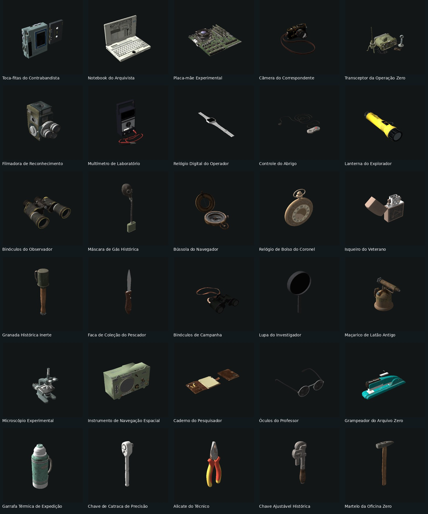

# Brainiac Collectibles

Adiciona 30 itens raros e únicos para encontrar e colecionar no SPT. Tem modelos próprios e tradução em cinco idiomas. Quem usa Weekend pode instalar o addon separado para completar as coleções e ganhar recompensas.



## Pacote

Brainiac Collectibles 1.3.0 inclui 30 itens, modelos, texturas e loot em cofres para SPT 4.1.6. Funciona sem Weekend. O addon opcional está no projeto separado [Brainiac Weekend Collections](https://github.com/maestroBR/brainiac-weekend-collections).

[Baixar a versão mais recente](https://github.com/maestroBR/brainiac-collectibles/releases/latest).

## Instalação

Feche o servidor antes de instalar. Extraia o pacote principal na pasta do SPT, onde fica `EscapeFromTarkov.exe`. O resultado deve ser:

```text
SPT_Runtime/user/mods/Maestro-BrainiacCollectibles/
```

Reinicie servidor e cliente. Quem joga pelo Fika precisa receber os bundles do mod principal pelo sistema de sincronização usado pelo grupo. Não copie apenas a DLL: `catalogue.json`, `bundles.json` e os 30 bundles fazem parte do pacote.

## O que encontrar

- **Tecnologia Esquecida:** câmeras, rádio, notebook e outros eletrônicos.
- **Relíquias de Campo:** binóculos, bússola, relógio e peças históricas.
- **Arquivo Brainiac:** instrumentos e objetos de pesquisa.

São itens de coleção. A faca, a granada histórica, o rádio e a lanterna não ganham funções de combate ou de equipamento. Loot usa pesos relativos nos cofres; não são chances independentes por raid. Veja [loot e regiões](docs/LOOT.md).

## Compatibilidade e testes

Destinado ao SPT **4.1.6**. O addon usa a API do WeekendDrops **1.0.7**. Builds e integridade do catálogo foram verificados; os 30 bundles já passaram por carregamento/renderização no Unity Editor. Esta separação em dois pacotes ainda precisa de validação em gameplay, incluindo host e cliente Fika. Veja [compatibilidade](docs/COMPATIBILITY.md).

## Desenvolvimento

O código do servidor está em `src/Collectibles`. As referências às DLLs do SPT e do Weekend são locais e não entram no repositório. [Compilação e pacotes](docs/DEVELOPMENT.md).

## Remoção

O addon pode ser retirado sem remover o mod principal; as coleções adicionadas por ele deixam de aparecer após reiniciar. O progresso já salvo pelo Weekend permanece.

Para remover os itens, faça backup e trate os objetos existentes nos perfis antes de retirar o mod principal. Não desinstale com itens personalizados ainda no inventário esperando que o jogo os reconheça sem o mod.

## Créditos

Modelos e texturas do [Poly Haven](https://polyhaven.com), licenciados em **CC0**, com autores e fontes em [CREDITS.md](CREDITS.md). Adaptação, otimização, cadastro de itens e integração: **Project Brainiac**. Código sob MIT; a licença dos modelos é mantida separadamente.

## Identificação

Mod GUID: `project.brainiac.collectibles`.

Use esse identificador ao cadastrar o mod no Forge.

## Idiomas

Nomes, nomes curtos e descrições dos 30 itens em inglês, alemão, russo, português brasileiro e chinês simplificado. O jogo escolhe a tradução conforme o idioma da interface. Arquivos editáveis em `content/locales`: `en`, `ge`, `ru`, `po` e `ch`, usando os códigos de idioma do SPT.
